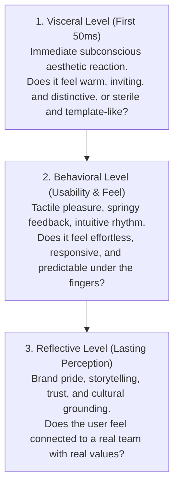

# Anti-Slop Craft & Emotional Design (Human-Centered UI)

> _"Good design is not just a checklist of accessibility ratios and grid units. Good design has soul, emotional resonance, and an unmistakable human touch that builds instant trust."_

---

## 1. The AI Design Paradox & Emotional Design

Modern AI code generators (v0, Bolt, Lovable, Cursor) often produce interfaces that pass automated accessibility audits with flying colors, yet users immediately reject them as **"AI slop"**—sterile, generic, repetitive, and emotionally hollow.

To build products that feel authentic, trustworthy, and human-crafted, digital interfaces must satisfy **Don Norman's 3 Levels of Emotional Design**:



1. **Visceral**: The immediate visceral aesthetic impact before a user even reads the text. Distinctive typography, intentional color palettes, and warm tactile shapes separate human craft from robotic regurgitation.
2. **Behavioral**: How the interface feels during use—smooth transitions, deliberate touch targets, micro-copy that speaks with empathy rather than robotic alerts.
3. **Reflective**: The lasting impression—authenticity, social proof, and regional or community grounding that make the user trust the application with their money, time, or identity.

---

## 2. The 7 Deadly Sins of AI Slop UI & Human Fixes

```text
┌───────────────────────────────────────┬────────────────────────────────────────┐
│ THE AI SLOP SYNDROME                  │ THE HUMAN CRAFT REMEDY                 │
├───────────────────────────────────────┼────────────────────────────────────────┤
│ 1. Bento Grid Monoculture (3x3 blocks)│ Asymmetric Layout & Editorial Rhythm   │
│ 2. Neon Radial Gradient Glow in Hero  │ Physical Lighting or Crisp Minimalism  │
│ 3. The "Icon in a Pastel Box" Cliché  │ Contextual Artifacts & Mini-Previews   │
│ 4. Corporate Buzzword Word Salad      │ Concrete "Noun-Action-Outcome" Copy    │
│ 5. Ghost Avatars & Fake Social Proof  │ Grounded Quotes with Real Context      │
│ 6. Hospital-Sterile Slate Monochrome  │ Expressive Accents & Warm Off-Whites   │
│ 7. Symmetrical Component Paralysis    │ Intentional Focal Points & Visual Weight│
└───────────────────────────────────────┴────────────────────────────────────────┘
```

### Sin 1: The Bento Grid Monoculture
- **The Slop**: Every landing page section is diced into identical $3 \times 3$ or $2 \times 2$ grid boxes with `rounded-2xl border border-slate-200/50 p-6`. Everything has the same visual hierarchy; nothing stands out.
- **The Human Fix**: Use **asymmetric editorial rhythm**. Pair a dominant 2/3 anchor feature card (with an active product demo or screenshot) with a 1/3 secondary detail rail. Use full-bleed testimonial quote banners or horizontal swipeable carousels to break the monotony.

### Sin 2: The Neon Radial Gradient Glow Orb
- **The Slop**: Placing two blurry, high-saturation circular blurs (`bg-purple-500/20 blur-3xl rounded-full absolute -top-40`) behind the Hero heading. This is the visual fingerprint of 2024 AI templates.
- **The Human Fix**: Replace blur spheres with:
  1. **Clean Architectural Whitespace**: Confident typography on subtle warm off-whites (`#fafaf9` / Stone-50 or `#f8f9fa`).
  2. **Subtle Tactile Textures**: Ultra-fine dot matrices (`bg-[radial-gradient(#e5e7eb_1px,transparent_1px)] [background-size:16px_16px]`) at $3 - 5\%$ opacity.
  3. **Real Product Photography / Video**: Let genuine software screenshots or human photos serve as the visual hero.

### Sin 3: The "Icon in a Pastel Box" Trap
- **The Slop**: Putting a generic 24px Lucide vector icon (`Sparkles`, `Zap`, `ShieldCheck`, `Layers`) inside a `w-12 h-12 rounded-lg bg-blue-100 text-blue-600 flex items-center justify-center` at the top of every feature card.
- **The Human Fix**: Replace generic icons with **functional miniature artifacts**:
  - Instead of a `Shield` icon for "Bank-Grade Security", display a mini animated toggle switch or a verified cryptographic hash pill.
  - Instead of a `Zap` icon for "Fast Execution", display an actual terminal snippet (`$ latency: 12ms`) or an interactive speed slider.
  - Instead of a `Sparkles` icon for "AI Powered", display an inline prompt pill showing a real input and dynamic output.

### Sin 4: The Corporate Buzzword Word Salad
- **The Slop**: Headings packed with empty marketing rhetoric:
  - ❌ *"Empower your enterprise with seamless, next-gen AI-driven paradigm transformation."*
  - ❌ *"Revolutionize your workflows with cutting-edge synergy."*
- **The Human Fix**: The **Noun-Action-Outcome** rule. Ground statements in specific customer reality:
  - ✅ *"Track your team's pull requests and catch deployment blockers before they reach staging."*
  - ✅ *"Built for Jakarta developers: hands-on Google Cloud and AI workshops every month."*

#### Banned Buzzword Dictionary in UI Copy:
| Banned AI Buzzword | Why It Feels Like Slop | Human Replacement |
| :--- | :--- | :--- |
| `Supercharge` | Hyperbolic, empty, overused by LLMs | `Automate`, `Speed up`, `Cut down` |
| `Seamless` | Vague promise that explains nothing | `In 1 click`, `Without leaving Slack` |
| `Next-Gen` | Lazy sci-fi branding with zero meaning | State exact year, tech stack, or feature |
| `Cutting-Edge` | Corporate cliché | Describe the underlying mechanism |
| `Empower` | Patronizing and non-specific | `Help you build`, `Let you control` |
| `Revolutionize` | False grandiosity | `Simplify`, `Consolidate`, `Replace` |
| `Game-Changer` | Unearned marketing claim | Provide a concrete benchmark metric |

### Sin 5: Ghost Avatars & Fake Social Proof
- **The Slop**: Testimonial cards featuring 2-letter initials inside gray circles ("JD", "SM") or AI-generated stock face photos with generic praise (*"This platform increased our growth by 300%!"* - John D., CEO).
- **The Human Fix**: Use **grounded, contextual social proof**:
  - Include specific organization names, verifiable links (e.g. GitHub handle, LinkedIn company, or Twitter avatar).
  - Quote concrete scenarios: *"When our Postgres cluster spiked during Black Friday, Nexaflow failover saved us 45 minutes of downtime."*
  - Include date stamps or version badges (e.g., *"Verified Customer • Oct 2024"*).

### Sin 6: The Hospital-Sterile Monochrome
- **The Slop**: Entire interfaces rendered in pure clinical `#ffffff` and `#0f172a` (Slate-900) without any warmth, accent playfulness, or visual personality.
- **The Human Fix**:
  - Use **warm off-whites** for base backgrounds: Stone-50 (`#fafaf9`), Zinc-50 (`#fafafa`), or warm paper neutrals (`#fbfbfa`).
  - Introduce an intentional **accent personality**: warm amber highlights, deep forest greens, or multi-color playful accent dots.
  - See the **GDG Jakarta Google 4-Color pattern** below.

### Sin 7: Symmetrical Component Paralysis
- **The Slop**: Every section has identical vertical padding (`py-12`), every card has identical width, and every row has 3 items. The eye scrolls without stopping because nothing creates visual tension or rhythm.
- **The Human Fix**: Vary layout pacing:
  - High-impact Hero: $112\text{ px}$ vertical padding (`py-28`), large display heading.
  - Dense interactive tool: compact $48\text{ px}$ padding (`py-12`).
  - Full-width quote/callout: asymmetrical split with $60\%$ quote text and $40\%$ author portrait.

---

## 3. Case Study: GDG Jakarta & The Human Community Interface

Analyzing `https://gdgjakarta.com/` reveals why a community site feels deeply human despite minor technical contrast infractions:

### 1. Typography: Medium Weight (`500`) Over Aggressive Bold (`700`)
- **Observation**: GDG Jakarta uses `Google Sans Flex` at `font-weight: 500` for its $96\text{ px}$ display `h1` and $59\text{ px}$ `h2`.
- **Psychological Effect**: Bold weights (`700` - `900`) feel aggressive, loud, and corporate. A medium weight (`500`) at large display sizes feels **airy, warm, editorial, and welcoming**.
- **Actionable Rule**: For hero titles larger than $56\text{ px}$, test `font-weight: 500` (Medium) or `font-weight: 600` (Semi-bold) before defaulting to heavy `font-bold` (`700`).

### 2. Pill Tokens (`rounded-full` / `9999px`)
- **Observation**: Navigation chips, filter tabs (*"All Activities"*, *"AI & Cloud"*), and main CTAs all use full pills (`border-radius: 9999px`).
- **Psychological Effect**: The human brain perceives sharp 90-degree corners and rigid boxes as boundaries. Full pill shapes invite fingertip contact and communicate informality and playfulness.

### 3. Playful Multi-Color Accents (Google 4-Color System)
- **Observation**: A vibrant palette of primary accents:
  - Google Blue: `#4285F4` (`rgb(66, 133, 244)`)
  - Google Red: `#EA4335` (`rgb(234, 67, 53)`)
  - Google Yellow: `#F9AB00` (`rgb(249, 171, 0)`)
  - Google Green: `#34A853` (`rgb(52, 168, 83)`)
- **Application**: Instead of a monotone blue-only or purple-only interface, using colorful tag badges or category dots sparks joy and visually categorizes topics naturally.

### 4. Human Presence: Authentic Community Photography
- **Observation**: 44 real photos of local Indonesian developers, speakers on stage, and workshop attendees.
- **Psychological Effect**: Social proof is visceral. Seeing real humans in recognizable physical environments builds 10x more trust than any 3D isometric render or Lucide icon grid.

---

## 4. The Anti-Slop Heuristic Audit Checklist

Before finalizing any frontend UI, verify against this 8-point checklist:

- [ ] **1. No Neon Blur Glows**: Are hero backgrounds free from arbitrary purple/blue blurry radial orbs?
- [ ] **2. No Bento Monoculture**: Is there at least one section that breaks the 3x3 identical card grid with asymmetric layout, full-bleed media, or horizontal carousels?
- [ ] **3. No Naked "Icon-in-a-Box"**: Are features illustrated with product screenshots, real UI controls, data tables, or mini-code snippets rather than isolated 24px Lucide icons in pastel boxes?
- [ ] **4. Zero Banned Buzzwords**: Is the copy free of "supercharge", "seamless", "next-gen", "cutting-edge", "empower", and "revolutionize"?
- [ ] **5. Concrete Nouns & Verbs**: Does every heading answer: *Who uses this? What exact task does it do? What concrete benefit occurs?*
- [ ] **6. Human Imagery & Proof**: Are avatars, speaker pictures, or case study quotes tied to real verifiable people or concrete customer stories?
- [ ] **7. Warmth & Texture**: Is the page background a comfortable warm off-white (or textured dark mode with physical depth), rather than flat clinical sterile gray?
- [ ] **8. Editorial Heading Weight**: Are display headings given generous line-height ($1.1 - 1.2$) and balanced font weight (e.g. `500` or `600`) to avoid aggressive yelling?
